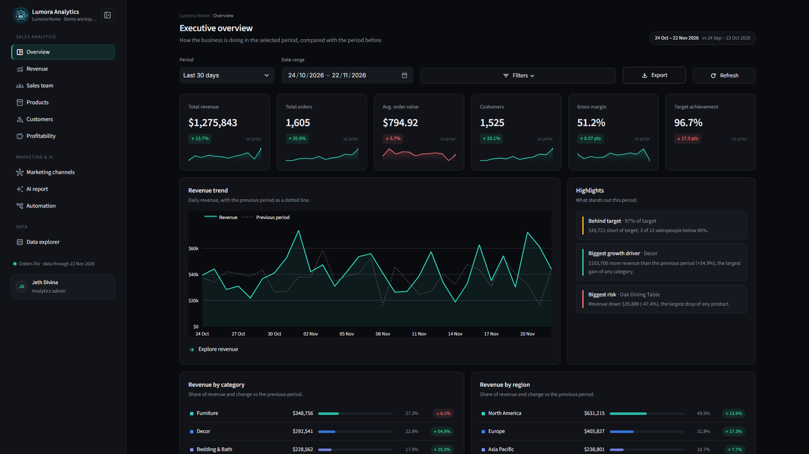
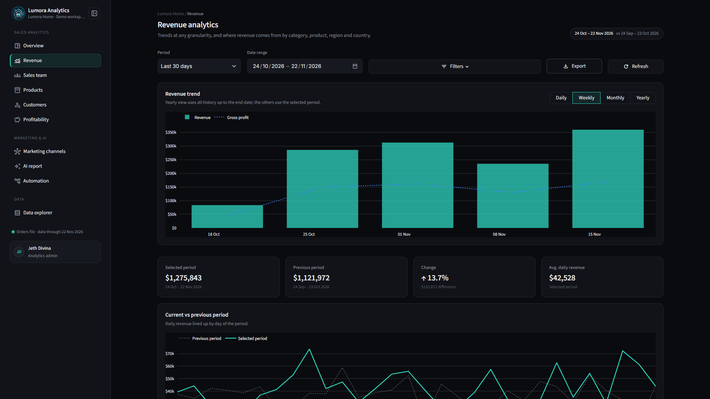
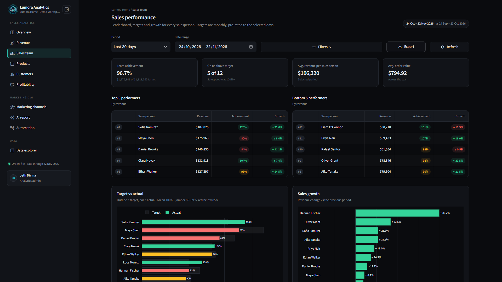
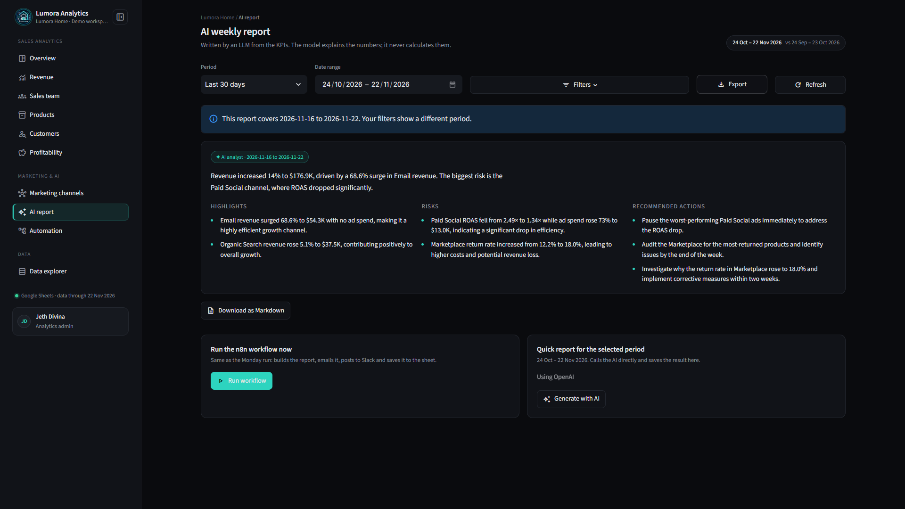

# Lumora Analytics: AI Sales Dashboard (Streamlit)

A dark, SaaS-style analytics dashboard for a fictional online store (**Lumora Home**), built with Streamlit, Plotly and custom CSS. It works alongside an n8n workflow that writes and emails an AI weekly report.

> **All data in this project is sample data for a fictional company.** Lumora Home does not exist; the orders, customers, salespeople and marketing figures are generated by `data/generate_sample_data.py`.

## Screenshots


*Overview: six KPIs vs the previous period, the revenue trend and up to three auto-generated highlights.*


*Revenue: daily, weekly, monthly or yearly trends, and the selected period against the one before.*


*Sales team: top and bottom performers, target achievement and growth for every salesperson.*


*AI report: the LLM-written weekly summary, with buttons to run the n8n workflow or generate a quick report.*

## How it works

Three parts work together:

1. **Dashboard (this repo):** Streamlit reads the data, calculates every KPI in Python (`core/bi.py`, `core/metrics.py`) and draws the charts.
2. **n8n workflow (`assets/n8n/`):** every Monday at 7 AM, or when you press **Run workflow** on the dashboard, it reads the sales data from Google Sheets, calculates the weekly KPIs in Code nodes, sends them to OpenAI, then emails the report, posts it to Slack and saves it back to the sheet for the dashboard.
3. **OpenAI (`gpt-4o-mini`):** receives the finished numbers and writes the summary, highlights, risks and recommended actions as JSON.

**The code calculates, the AI explains.** The model never computes a metric; it only puts numbers that were already calculated into words, so the figures in the report always match the dashboard.

## Features

**Sales analytics** (order-level data, `data/orders.csv` + `data/sales_targets.csv`)
- **Overview:** the 10-second view: 6 KPIs (revenue, orders, AOV, customers, gross margin, target achievement) vs the previous period with 12-week sparklines, one revenue trend, up to 3 auto-generated highlights, and compact revenue breakdowns by category and region. Details live on the other pages.
- **Revenue:** daily, weekly, monthly and yearly trends; current vs previous period; revenue by category, product, region and country (map); contribution treemap
- **Sales team:** leaderboard, revenue/orders/AOV per salesperson, target vs actual, growth, top 5 and bottom 5
- **Products:** top/bottom 10 by units, revenue or profit; highest revenue and profit; units per product; category performance; revenue vs margin; products declining year on year
- **Customers:** unique, new vs returning, top 10 customers, average spend, repeat purchase rate, purchase frequency, revenue by segment
- **Profitability:** gross and net profit and margins, gross-sales-to-net-profit waterfall, margin trend, profit by category and region, most and least profitable products, discount impact by segment

**Marketing & AI** (daily channel data, `data/lumora_daily_sales_2026.csv`)
- **Marketing channels:** sessions, conversion, ROAS and returns by channel, with alerts
- **AI report / Automation:** the LLM weekly report from the n8n workflow, and how the workflow runs

**Everywhere:** period presets and custom date range, filters (region, category, salesperson, segment, sales channel, marketing channel), CSV export, refresh, empty and error states.

## Metric definitions

| Metric | Definition |
|---|---|
| Revenue | Net sales after discounts |
| Orders / Units | Distinct order IDs / sum of quantity |
| AOV | Revenue ÷ orders |
| Revenue growth | Revenue vs the previous period of the same length |
| Target achievement | Revenue ÷ monthly targets pro-rated to the days selected |
| Gross profit | Revenue − cost of goods sold |
| Net profit | Gross profit − shipping cost (no overheads in the data) |
| New customer | First order ever falls inside the selected period |
| Repeat purchase rate | Share of the period's customers with 2+ orders ever |
| Declining product | Last 3 months' revenue down 10%+ vs the same months a year earlier |

All data is **sample data** for a fictional company, generated by `data/generate_sample_data.py` (fixed seed). Replace `data/orders.csv` and `data/sales_targets.csv` with real exports in the same columns to use your own.

## Run it

```bash
python -m venv .venv && source .venv/bin/activate   # Windows: .venv\Scripts\activate
pip install -r requirements.txt
streamlit run app.py
```

The dashboard runs on the local sample files with no setup. To turn on the AI and n8n features, add your secrets:

1. Copy the example file:
   ```bash
   cp .streamlit/secrets.toml.example .streamlit/secrets.toml   # Windows: copy .streamlit\secrets.toml.example .streamlit\secrets.toml
   ```
2. Fill in the values you need (all are optional):
   ```toml
   OPENAI_API_KEY = "sk-..."          # enables "Generate with AI" on the AI report page
   GSHEET_ID = "1AbC..."              # the long ID in your Google Sheet's URL (see "Connecting to n8n")
   N8N_WEBHOOK_URL = "https://..."    # Production URL of the "Run from dashboard" Webhook node
   ```
3. Restart the app.

`ANTHROPIC_API_KEY` also works if you prefer Claude; OpenAI is used when both are set. `.streamlit/secrets.toml` is in `.gitignore`, so your keys are never committed.

## Project structure

```
app.py                 entry point: page config, sidebar, filters, routing
core/bi.py             sales BI logic: KPIs, targets, breakdowns, products, customers, profit
core/data.py           loads the marketing CSV and the AI report (local or Google Sheets)
core/metrics.py        marketing KPI definitions, channel table, alert rules
core/ai.py             OpenAI / Claude API call (same prompt as the n8n workflow)
ui/theme.py            colours, number formats, Plotly theme
ui/components.py       KPI cards, alerts, tables, header, sidebar
ui/charts.py           Plotly charts (marketing)
ui/bi_charts.py        Plotly charts (sales BI)
views/*.py             one module per page
assets/style.css       all custom styling
assets/n8n/            the n8n workflow JSON
data/                  sample data, its generator script, and the latest AI report
```

## Using real data

Replace `data/lumora_daily_sales_2026.csv` with an export that has the same columns
(`date, channel, sessions, orders, revenue_usd, ad_spend_usd, returns, new_customers`), or change `core/data.py` to read from a database, Google Sheets or Shopify. Every number on screen is calculated from that file.

## Connecting to n8n

The dashboard and the n8n workflow share one Google Sheet:

```
n8n (Monday 7 AM or "Run workflow" button) ──writes──▶ Google Sheet ◀──reads── Streamlit dashboard
        ▲                                                                            │
        └──────────────────── webhook call ("Run workflow") ─────────────────────────┘
```

1. Create a Google Sheet with two tabs:
   - `daily_sales`: import `data/lumora_daily_sales_2026.csv`
   - `ai_reports`: header row `week_start, week_end, generated_at, section, text`
2. Share the sheet as **Anyone with the link can view** (the dashboard reads it without a login).
3. Import `assets/n8n/ai-weekly-sales-report.n8n.json` into n8n, put the sheet ID in both Google Sheets nodes, add credentials, and **activate** the workflow. The report is written by OpenAI (`gpt-4o-mini`): create a **Header Auth** credential named **OpenAI API key** with name `Authorization` and value `Bearer <your OpenAI key>`, and select it in the **AI: write weekly report** node. Google Sheets, Gmail and Slack use their usual n8n credentials.
4. Open the **Run from dashboard** Webhook node and copy its **Production URL**.
5. Copy `.streamlit/secrets.toml.example` to `.streamlit/secrets.toml` and fill in `GSHEET_ID` and `N8N_WEBHOOK_URL`.
6. Restart the dashboard. The sidebar shows **Google Sheets** as the source, and the AI report page's **Run workflow** button starts the n8n workflow. After a minute, press **Refresh** to see the new report.

Data is cached for 5 minutes; **Refresh** reloads it straight away.
